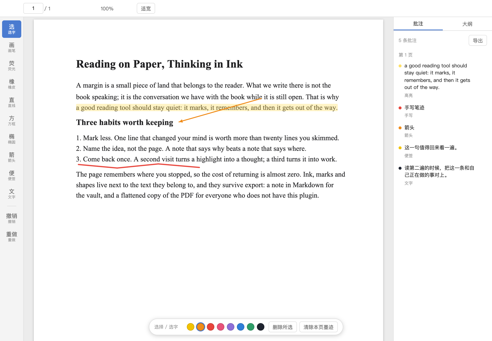
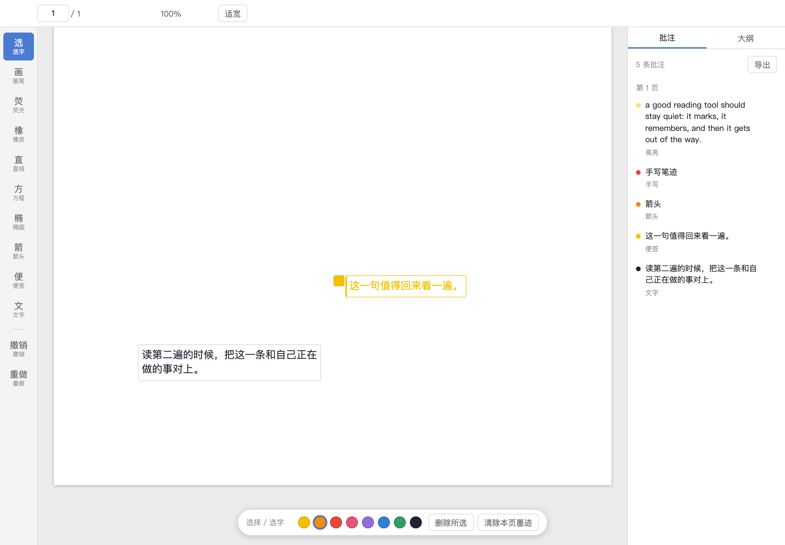

# PDFmark

**Read and annotate PDFs inside Obsidian — highlights, ink, shapes and notes that stay in your vault.**

PDFmark 是一个 Obsidian 插件：直接在库里读 PDF，随手划线、写字、画框，批注能导出成笔记，也能烧进 PDF 文件本身。





- Free and open source (MIT). No account, no subscription, no ads, no telemetry.
- Works offline. The plugin never sends your files or reading data anywhere.
- Desktop and mobile (macOS / Windows / Linux / iPadOS / iOS / Android).
- 免费、开源（MIT）、离线可用，不上传任何文件与阅读数据。

---

## Features

| | |
| --- | --- |
| **Text marks** | Select any part of a line and apply highlight, underline or strikethrough in 8 colours. Partial lines and multi-line selections are supported. 选中词组即可高亮 / 下划线 / 删除线，支持只选半行与跨行。 |
| **Freehand ink** | Pen and highlighter with adjustable width and colour, pressure-free, works with a stylus, a mouse or a finger. 画笔与荧光笔，粗细、颜色可调，触控笔 / 鼠标 / 手指都能写。 |
| **Shapes** | Line, rectangle, ellipse and arrow; drag to draw, drag again to move, resize from the handles. 直线 / 方框 / 椭圆 / 箭头，画完可拖动、可拉伸。 |
| **Text boxes** | Click anywhere and type — Chinese, English, any script your device can display. 在页面上任意位置添加文字批注，中英文都行。 |
| **Sticky notes** | Point notes with an editable body, listed in the sidebar. 便签批注，内容会显示在页面上而不是变成一个小图标。 |
| **Eraser** | Erase a whole stroke or a single annotation, one click. 点一下整条擦掉，不用来回涂。 |
| **Reading position** | Reopens at the page and scroll offset you left, with a page-number box and a bookmark outline. 记住上次读到哪一页、滚到哪里，可输页码跳转，也能用 PDF 自带目录。 |
| **Sidebar** | All annotations for the current file, click to jump to it. 右侧列出本文件全部批注，点击定位。 |
| **Export** | Turn annotations into a Markdown note with quotes, colours and page links (`[[file.pdf#page=12]]`). 一键导出 Markdown 笔记，带原文引用与页码双链。 |
| **Burn-in** | Write the annotations into the PDF itself, so any reader sees them. The original file is backed up first. 把批注烧进 PDF，任何阅读器都能看到，原文件自动备份。 |
| **Extras** | Night inversion, crop white margins, zoom / fit-width, undo & redo (80 steps), per-file annotation store. 夜间反色、裁白边、缩放适宽、80 步撤销重做。 |
| **Two languages** | The whole interface — tool rail, menus, dialogs, settings, exported notes — is available in English and Chinese, switchable in the settings; the default follows your Obsidian language. 界面支持中英文，可在设置里切换，默认跟随 Obsidian 的语言。 |

---

## Installation

**From the community directory** (after the plugin is published): Settings → Community plugins → Browse → search for **PDFmark** → Install → Enable.

**Manually**: download `main.js`, `manifest.json` and `styles.css` from the latest release, put them in `<vault>/.obsidian/plugins/pdfmark/`, then enable **PDFmark** in Settings → Community plugins. Reload Obsidian if it does not show up.

**安装**：市场里搜 **PDFmark** 安装；或把 release 里的三个文件放进 `<库>/.obsidian/plugins/pdfmark/`，在「第三方插件」里启用。

PDFmark does **not** take over `.pdf` by default. Open a PDF with it through the ribbon icon, the file context menu (“Open with PDFmark”), or the command palette. If you want double-click to work, enable **Take over .pdf by default** in the plugin settings: Obsidian then hands the PDF to PDFmark as soon as it opens, and PDFs already open are switched over too. It can be turned off at any time without affecting other PDF plugins.

默认**不接管** `.pdf` 的打开方式，不会和你已有的 PDF 插件打架。用左侧图标、右键菜单「用 PDFmark 打开」或命令面板进入即可；想双击直接打开，在设置里打开「接管 .pdf 默认打开方式」，之后打开 PDF 会自动换成 PDFmark 的阅读视图，已经打开的也会换过来，随时可以关掉。

---

## Usage

1. Open a PDF. The left rail holds the tools, the bottom bar holds the options for the active tool.
2. **Select** — drag across text. A floating menu appears: highlight / underline / strike / note, a six-colour quick row (the bottom bar holds all eight), copy, quote. Selecting part of a line works: drag from the first character you want to the last.
3. **Pen / highlighter** — draw. Width and colour come from the bottom bar.
4. **Shapes** — drag to create; drag inside to move; drag a corner to resize. Stroke width goes up to 13 pt, which is as heavy as a marker page mark ever needs.
5. **Text box** — click once, type in the dialog, confirm. The bottom slider becomes **font size** (6–30 pt) for this tool. Click an existing box to edit it, drag to move it; with a box selected the slider resizes *that* box without touching the default for new ones.
6. **Note** — click once and type; the text is drawn on the page, not hidden behind an icon. Notes use the same font-size slider (6–30 pt).
7. **Eraser** — click an annotation to delete it, or press `Delete` with something selected.
8. Top bar: page number box, page count, zoom, fit width, night mode, crop margins. Right sidebar: annotations and outline.
9. **More (⋯)** — export to Markdown, copy a citation for the current page, burn annotations into the PDF, clear annotations.

**Moving things does not require switching tools.** Whatever tool is active, press an annotation of that same kind and drag it: a note with the note tool, a box with the box tool. Ink is the one place where this is a choice, because pressing on a stroke usually means "continue writing": with the pen or highlighter, a press inside 4 px of existing ink starts a new stroke — switch on **Drag ink when the pen presses on it** in the settings if you would rather move the old stroke, and note that **Select** always moves it. Only the outline of a rectangle or ellipse grabs with a drawing tool, so you can still draw a new box *inside* an old one. With **Select** armed, anything you can move — including ink — moves, and dragging empty space selects text. Text marks are the exception on purpose: they are tied to the words they mark and stay put. The cursor turns into a four-way arrow wherever a drag will work.

Shortcuts: `Ctrl/Cmd+Z` undo, `Ctrl/Cmd+Shift+Z` redo, `Esc` close the floating menu.

---

## Language

The interface is fully translated into English and Chinese. **Settings → PDFmark → Language → Interface language** offers *Follow system* (default), *中文* and *English*; *Follow system* uses your Obsidian UI language, falling back to the system locale.

Switching applies immediately to the settings page and to every open PDF — tool rail, menus, dialogs, the sidebar and the empty states. Two things are registered with Obsidian once at load time and therefore update after a restart: the command palette entries and the ribbon tooltip. Exported Markdown follows the same setting (headings, type labels and page links are written in the active language), so the same vault can hold notes in either language depending on when they were exported.

## How burning handles text and fonts

Two things people ask about right away:

**“My sticky note becomes a small icon after burning.”** It does not any more. When a note is burned, its body is drawn on the page as readable text next to a small coloured marker, so every reader — including phones and print-outs — shows the content, not an `i` in a box.

**“Free text in Chinese?”** Type a text box, in Chinese, English or any script your device has fonts for. Burning renders the text at about 288 dpi and embeds it as an image, which means:

- no font file is copied or redistributed with the plugin — so there is no font licence to worry about;
- it looks exactly like it does on screen, in every viewer;
- the trade-off is that burned text is not selectable/searchable inside the PDF. The text itself is still stored with the annotation and exported to Markdown, so nothing is lost — check the export if you need the words as text.

PDFmark bundles **no fonts at all**; it uses the ones already on your device (PingFang on Apple platforms, Microsoft YaHei on Windows, Noto on Linux/Android). The only font data inside `main.js` is the fallback set that pdf.js itself ships for PDFs that reference non-embedded standard fonts — attributed in [THIRD-PARTY-NOTICES.md](./THIRD-PARTY-NOTICES.md).

**烧入时的便签与字体**：便签内容会作为真实文字画在页面上，不再只剩一个小图标；文字批注支持中英文，烧入时按约 288 dpi 渲染成图片写进 PDF，因此不复制、不再分发任何字体文件，不涉及字体版权。代价是烧入后的文字不可再被 PDF 选中搜索，但原文仍保存在批注数据里，也能导出到 Markdown。插件本身不打包任何字体，只用你设备上已有的字体。

---

## Where your annotations live

Annotations are stored **inside your vault**, in the plugin's own data file (`.obsidian/plugins/pdfmark/data.json`), keyed by the PDF path. Your PDFs and notes are never modified unless you explicitly choose **Burn into PDF**.

- Nothing leaves the device; there is no sync service and no server.
- Back up that data file if you reinstall or move vaults.
- **Burn into PDF** writes the annotations into the file contents. A timestamped copy of the original is kept in `.obsidian/plugins/pdfmark/backups/`. Burning is one-way — afterwards the marks are part of the page and can no longer be edited separately, so keep the backup.
- 批注存在库内的插件数据文件里，不改动你的 PDF 与笔记；只有你主动点「烧入 PDF」才会写入文件，并在插件目录留一份带时间戳的备份。烧入不可逆。

---

## Privacy

PDFmark makes **no network requests**. No analytics, no crash reporting, no update checks, no remote fonts, no remote code. The PDF engine (pdf.js) and the shape writer (pdf-lib) are bundled into `main.js` and run locally; documents are parsed on your device.

PDFmark **不发起任何网络请求**：无统计、无上报、无远程字体、无远程代码，PDF 解析全部在本机完成。

The clipboard is written to only when you press **Copy** or **Quote**, and is never read. 剪贴板只在你点「复制」或「引用」时写入，从不读取。

If you want to verify this, search the source for `fetch`, `XMLHttpRequest` or `http` — you will not find any.

### A note on the bundled pdf.js

The plugin bundles pdf.js 3.11, which `npm audit` flags for CVE-2024-4367 (a
malicious PDF could reach `new Function` through a crafted font). PDFmark does
not use that path: `isEvalSupported` is forced to `false` and the build strips
`new Function`, `eval` and the dynamic `<script>` loader from the bundle, so
pdf.js falls back to its own non-eval font interpreter. The bundling step fails
the build if any of those tokens reappear, which also keeps the plugin inside the
community directory's "no dynamic code" rule. Upgrading to pdf.js 4.x is planned
but is a breaking change for the viewer.

**关于内置的 pdf.js**：内置的是 3.11，`npm audit` 会报 CVE-2024-4367（恶意 PDF 可借字体数据触达 `new Function`）。本插件不走这条路径：`isEvalSupported` 固定为 `false`，且构建时会把 `new Function`、`eval` 与动态 `<script>` 加载器一并剥离，pdf.js 只会使用自带的非 eval 字体解释器；这些字样一旦重新出现，构建会直接失败。升级到 pdf.js 4.x 已列入计划，但属于破坏性改动。

---

## Compatibility

- Obsidian **1.8.7** or newer (the version that added `getLanguage()`).
- Desktop: macOS, Windows, Linux. Mobile: iOS/iPadOS and Android (pinch to zoom, scroll to pan).
- Does not conflict with other PDF plugins; `.pdf` handling is opt-in.
- 需要 Obsidian 1.8.7+（`getLanguage()` 从这个版本才有）；桌面与移动端都可用；与其他 PDF 插件不冲突。

---

## Disclaimer

PDFmark is an independent, community-made plugin. It is **not** affiliated with, endorsed by, or sponsored by Obsidian, Adobe, Mozilla, or the authors of any other PDF plugin.

- **No warranty.** The software is provided “as is”, without warranty of any kind. See the [MIT License](./LICENSE).
- **Back up important files.** Burning annotations rewrites the PDF. Although PDFmark keeps a backup copy, you are responsible for your own data.
- **Trademarks.** “Obsidian” is a trademark of Dynalist Inc. “Adobe” and “Acrobat” are trademarks of Adobe Inc. “PDF” refers to the open ISO 32000 standard; the name PDFmark is used descriptively and does not imply any endorsement.
- **Fonts.** PDFmark does not bundle any font. Text you type is drawn with the fonts already installed on your device, and burning a text box into a PDF renders it as an image at high resolution — so no font file is redistributed and no font licence is required from you.
- **Your content, your rights.** You are responsible for holding the rights to the documents you open and for how you share annotated copies.

**免责声明（中文）**

PDFmark 是独立的个人开源项目，与 Obsidian、Adobe、Mozilla 及其他 PDF 插件作者无任何隶属或背书关系。

- **不提供任何担保**。软件按“现状”提供，详见 [MIT 许可证](./LICENSE)。
- **请自行备份重要文件**。烧入批注会重写 PDF；插件虽会留存备份，但数据安全由你自行负责。
- **商标**：“Obsidian” 是 Dynalist Inc. 的商标，“Adobe”“Acrobat” 是 Adobe Inc. 的商标，“PDF” 指 ISO 32000 开放标准；本插件名称仅作描述性使用，不代表任何背书。
- **字体**：插件不打包任何字体文件。文字批注使用你设备上已有的字体显示，烧入时按高分辨率渲染成图片写入 PDF，因此不涉及字体再分发，也不会给你带来字体版权问题。
- **内容权利**：你需自行确保对所阅读文档拥有相应权利，并对批注后文档的传播负责。

---

## License

[MIT](./LICENSE) © 2026 Jiaosen. Use it, fork it, ship it — just keep the copyright notice.

Third-party components bundled into `main.js` (pdf.js — Apache-2.0, pdf-lib — MIT, Adobe CMap tables and Foxit/Liberation fonts shipped by pdfjs-dist) keep their own licences; full texts are in [THIRD-PARTY-NOTICES.md](./THIRD-PARTY-NOTICES.md).

---

## Credits

The feature set was inspired by reading tools the community already loves — Ink-Annotation, PDF.notes and PDF++ — but PDFmark shares **no code** with them: it is an independent implementation built on pdf.js and pdf-lib. Credit for those ideas belongs to their authors.

---

## Development

```bash
npm install
npm run build      # bundles src/ into main.js (pdf.js worker + CMap + fonts inlined)
npm run dev        # watch mode
npm test           # headless Chrome regression suite (46 assertions)
npm run typecheck  # tsc --noEmit, no errors expected
npm run lint       # the community-directory rule set, offline
```

The source is fully type-checked; `lint` reports 0 errors and, as of 1.1.8, only
the two findings that would need Obsidian 1.13.0 to fix.

The build inlines every runtime asset into `main.js`, because the community installer only downloads `main.js`, `manifest.json` and `styles.css`.

---

## 中文说明

下面集中写日常会用到的部分；安装、隐私、兼容性、开发见上方各节末尾的中文摘要。

### 它是什么

在 Obsidian 里直接读 PDF 并做批注：划线、写手写、画图形、加文字和便签，批注可以导出成 Markdown 笔记，也可以烧进 PDF 文件本身。免费、开源（MIT）、离线、不上传任何数据。

### 怎么用

打开 PDF 后，左侧是工具条，底部是当前工具的参数：

1. **选中**：拖选文字，弹出菜单里选高亮 / 下划线 / 删除线 / 批注，菜单里有 6 种常用色（底栏是全部 8 种），也能复制或生成引用。支持只选半行、跨行选。
2. **画笔 / 荧光笔**：直接写，粗细和颜色在底部调。
3. **直线 / 方框 / 椭圆 / 箭头**：拖出一个，画完还能拖动、拉伸；粗细可调到 13 pt，再粗就没有使用场景了。
4. **文字**：点一下页面，输入中英文，确定即可；底部滑块此时是**字号**（6–30 pt）。双击已存在的文字框可以改；选中某一张卡时拖滑块只改这一张，不影响以后新建的默认字号。
5. **便签**：点一下写内容，文字会直接显示在页面上，不会只剩一个小图标；字号同样用底部滑块调（6–30 pt）。
6. **橡皮**：点一下整条删除，也可以用 `Delete` 键。
7. 顶栏：页码输入、总页数、缩放、适宽、夜间反色、裁白边。右侧：批注列表与 PDF 目录。
8. **更多（⋯）**：导出 Markdown、复制当前页引用、烧入 PDF、清除批注。

**移动标注不用切换工具**：当前是什么工具，就按住同类标注直接拖——便签工具拖便签、方框工具拖方框。只有手写笔迹需要你自己定规矩：按在笔迹边上起笔，通常是想接着写，所以画笔 / 荧光笔默认**继续起笔**；想让它们按住已有笔迹就拖动，去设置里打开「画笔按住已有笔迹时拖动它」，而「选中」工具任何时候都能拖。用图形工具时只有**边框**能命中，框内仍然可以继续画新的框；用「选中」时任何能移动的东西（包括手写）都能拖，空白处拖动仍然是划词。高亮 / 下划线 / 删除线是唯一不参与拖动的类型——它们绑在所标的文字上。鼠标移到能拖的位置会变成四向箭头。

### 界面语言

界面完整支持中英文：**设置 → PDFmark → 语言 → 界面语言**，可选「跟随系统」（默认）、「中文」、「English」。「跟随系统」读的是 Obsidian 的界面语言，取不到时用系统语言。

切换后立即生效的范围：设置页本身、所有已打开的 PDF（工具条、菜单、弹窗、侧栏、空状态文案）。有两处是 Obsidian 在插件加载时注册一次的，需要重启才跟着变：命令面板里的命令名、侧栏图标的提示文字。导出的 Markdown 也跟着当前语言走（标题、类型标签、页码链接都用当前语言），所以同一个库里可能同时存在中英文两种导出的笔记。

### 数据在哪

批注保存在库内的 `.obsidian/plugins/pdfmark/data.json`，按 PDF 路径归档，不改动你的 PDF 和笔记。只有主动「烧入 PDF」才会写进文件，并在插件目录 `backups/` 留一份带时间戳的原始副本。换库或重装插件前请备份这个文件。

### 常见问题

- **双击 PDF 还是用别的软件打开？** 默认不接管。设置里打开「接管 .pdf 默认打开方式」，之后打开 PDF 会换成 PDFmark（已打开的也会换过来）。
- **扫描件选不中字？** 扫描件没有文字层，用画笔、方框或文字框标注。
- **烧入后还能改吗？** 不能，批注已经成为页面内容。所以插件会先备份原文件，建议保留。
- **会不会把我的文件传到网上？** 不会。插件没有任何网络请求。

### 免责声明

见上文 Disclaimer 一节：软件按“现状”提供、不提供担保，请自行备份重要文件；插件与 Obsidian、Adobe、Mozilla 无隶属关系；不打包任何字体，因此不涉及字体版权。
